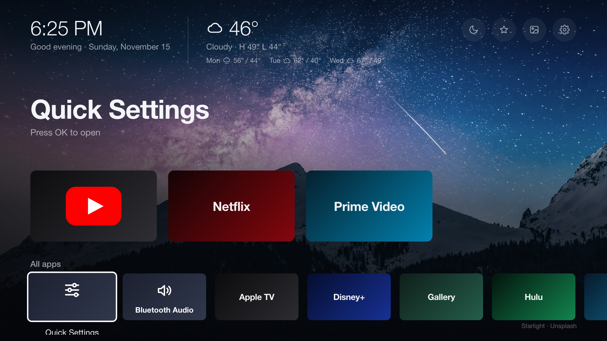

# Samsung TV Revamp

A home-screen app for Samsung Smart TVs: a clean dashboard with your favourite apps, a clock, the weather, rotating
photography and a photo screensaver. You edit the favourites with the TV remote, no phone or computer needed after the install.



It installs as a normal app called **Home** (via Samsung's Developer Mode). It does **not** replace Samsung's own home
screen and needs no hacking, root, or account changes. You open it from the Apps bar like any other app.

**What you get**

- Favourite apps as large tiles (YouTube, Netflix, Prime Video by default), plus an "All apps" row. Shortcuts to Quick Settings (sound output) and Bluetooth Audio.
- Edit favourites on the TV: add, remove and reorder with the remote.
- Clock, greeting and a 3-day weather forecast ([Open-Meteo](https://open-meteo.com), no account or API key).
- Background photos (nature, Nepal) that rotate, shuffled so nothing repeats until every photo has been shown.
- Screensaver with slow pan-and-zoom photos, a moving clock and photo captions. It can keep Samsung's own screensaver off while it runs.
- When you close an app you started from Home (for example with Back), you land back on Home.
- No ads, no analytics, no tracking. The only network calls are weather requests.

**Tested on:** Samsung UN75TU690TFXZA (2021, Tizen 6.0). Other 2019–2023 Samsung Smart TVs (Tizen 5.0–7.0) should work, but I have not tested them. LG, Android TV and Fire TV are not supported.

---

## Before you start

You need:

| | |
|---|---|
| A Samsung Smart TV | Tizen-based (almost every Samsung Smart TV since 2015). |
| A computer on the same Wi-Fi/network as the TV | Tested on a Mac (Apple Silicon). Linux should work; Windows is untested (use WSL). |
| A free Samsung account | For the developer certificate (step 4). |
| [Node.js](https://nodejs.org) 20 or newer | Run `node -v` to check. |
| [Visual Studio Code](https://code.visualstudio.com) with the **Tizen extension** (search "Tizen" in the Extensions view) | Creates your certificate and installs the Tizen tools (including the `tizen` command-line tool) this project uses. |
| About 30 minutes | Most of it is the one-time certificate setup. |

> **Apple Silicon Mac:** Tizen's `sdb` tool is built for Intel. Install Rosetta once: `softwareupdate --install-rosetta --agree-to-license`.

## Step by step

### 1. Get the code

```
git clone https://github.com/sooshil/samsung-tv-revamp.git
cd samsung-tv-revamp
npm install
```

### 2. Put your TV into Developer Mode

1. On the TV, open **Apps**.
2. Using the remote's number pad (or the on-screen digits), type **12345**.
3. A *Developer mode* window opens. Switch it **On** and type your **computer's IP address** in *Host PC IP*.
   (Find it on a Mac: *System Settings → Network → your connection → Details*, or run `ipconfig getifaddr en0`.)
4. Press OK, then **turn the TV off and on again** (use the remote's power button).

Also note your **TV's IP address**: *Settings → General → Network → Network Status → IP Settings* (the menu names vary slightly by model).

> Tip: your router assigns IPs automatically and they can change. If the install later says it can't connect, check the TV's IP again.
> Reserving an address for the TV in your router's settings ("DHCP reservation") prevents this.

### 3. Tell the project about your TV and your location

```
cp config/example.local.env config/local.env
cp config/example.local.json config/local.json
```

Edit **`config/local.env`**: set `TV_IP` to your TV's IP address, and `TIZEN_SDK` to the folder where the Tizen tools were installed by the extension
(default `~/tizen-studio`; it contains `tools/ide/bin/tizen`).

Edit **`config/local.json`** (optional, only for the weather): your place name and latitude/longitude.
To find the numbers, right-click your home in Google Maps and click the coordinates to copy them.

```
{ "weather": { "name": "Springfield", "lat": 39.80, "lon": -89.64 } }
```

Both files are **git-ignored: they stay on your computer and are never committed**. The build rounds your coordinates to
about 1 km before using them, and the weather service only ever sees the rounded value. Skip `local.json` and the weather
widget is simply hidden.

### 4. Create a Samsung developer certificate (one time)

Samsung only lets apps run on a TV if they are signed with a certificate that knows your TV. You create it once.

1. In VS Code, install the **Tizen** extension (Extensions view → search "Tizen"). Follow its prompts to install the Tizen tools if it asks.
2. Open the Command Palette (**Cmd/Ctrl + Shift + P**), type **Tizen**, and choose the certificate command (*Certificate Manager*). Create a new **Samsung** certificate for **TV**, and sign in with your Samsung account when asked.
3. Choose **Public** / **Individual**, give it a name, and set a **password** (keep it in a password manager; it can't be recovered).
4. When it asks for your TV's **DUID**, let the extension read it from the TV: the TV must be in Developer Mode (step 2) and reachable at its IP address. Add the TV to the certificate.
5. Finish. The certificate files (`author.p12`, `distributor.p12`) are saved on your computer, normally under `~/SamsungCertificate/<name>/`.

> The extension's menu wording changes between versions. If a name above doesn't match, search the Command Palette for "Tizen" and look for the certificate and device options.

Now check that the command-line tool can see the signing profile:

```
source scripts/env.sh
$TIZEN_CLI security-profiles list
```

- If your profile is listed, put its name in `config/local.env` as `SIGN_PROFILE=<name>`.
- If the list is empty, register the certificate (it asks for the password, which is never saved):
  `scripts/register-signing-profile.sh ~/SamsungCertificate/<name>`

**Never commit or share** your `.p12` files or password. This repo's `.gitignore` already excludes them.

### 5. (Optional) Try it on your computer first

```
npm run dev
```

Open <http://localhost:8080>. Arrow keys move, Enter selects, Backspace is Back. It shows sample apps, so you can
see the look before touching the TV.

### 6. Install on the TV

```
source scripts/env.sh
npm run deploy
```

This builds the app, signs it, installs it on your TV and starts it. When it finishes, **Home** appears on the TV.
To start it again later: Apps bar → **Home**.

If you see *"install failed"* or a certificate error, see **Troubleshooting** below.

---

## Using it

| Do this | To |
|---|---|
| ◀ ▶ ▲ ▼ and **OK** | Move around and open an app |
| Top-right **moon** | Start the screensaver now (any key ends it) |
| Top-right **star** | Edit favourites (below) |
| Top-right **picture** | Next background photo |
| Top-right **gear** | Settings: photo set, animations, weather on/off, °F/°C, screensaver delay, return-to-Home on/off |

**Editing favourites:** press **OK** on a favourite to pick it up → **▲ ▼** to reorder, **◀** to remove, **OK** or **Back** to put it down.
Press OK on any other app in the list to add it to your favourites. You can have 1 to 10. Changes save immediately.

## Things it can't do (Samsung's limits)

- **It cannot replace Samsung's Home screen** or take over the Home button.
- **It cannot start by itself when the TV turns on.** Open it from the Apps bar. (Settings → General → Smart Features → *Autorun Last App* may help; behaviour differs per model.)
- **Back from some apps doesn't return to Home.** YouTube, Prime Video and ZEE5 do. Netflix ignores Back; its Exit key goes to Samsung TV Plus, not to Home.
- **No way to change the sound output programmatically.** The *Quick Settings* tile opens Samsung's own panel for that.
- Samsung's own *Settings* app can't be opened from third-party apps.

Details and measurements are in [`docs/`](docs/).

## Troubleshooting

| Problem | Try |
|---|---|
| `Set TV_IP in config/local.env` | Step 3. Then run `source scripts/env.sh` again. |
| Can't connect to the TV | TV and computer must be on the same network. Check the TV's IP (it can change). Developer Mode must be On and your computer's IP entered, then restart the TV. Test: `$SDB connect $TV_ADDR`. |
| `sdb: Bad CPU type` / `cannot execute binary` on a Mac | Install Rosetta (see *Before you start*). |
| Install fails with a certificate / "permission" error | The TV's DUID must be in your certificate (step 4.4), the certificate must be *Public / Individual* for TV, and the profile name in `SIGN_PROFILE` must exist (`$TIZEN_CLI security-profiles list`). |
| Install works but the app doesn't appear | Open **Apps** on the TV and look for **Home** (it may be at the end of the list); or restart the TV. |
| No weather | Check `config/local.json`; rebuild with `npm run deploy`. The TV needs internet access. |
| Photos look soft | Photos are 1920×1080 (the TV's resolution) on purpose, to save memory. |

## Remove it

```
source scripts/env.sh
$TIZEN_CLI uninstall -p tvrevamp00.Dashboard -s $TV_ADDR
```

(or on the TV: Apps → Settings gear → highlight **Home** → *Delete*). Nothing else on the TV is changed. You can also turn Developer Mode off again (Apps → 12345 → Off).

## Make it yours

- **Favourites, photos, weather, temperature unit:** on the TV, from Settings.
- **Your own photos:** put 1920×1080 JPEGs in `assets/backgrounds/` and list them in `src/services/backgrounds.ts`. Only add pictures you have the right to use, and keep their credits in `assets/backgrounds/CREDITS.md`.
- **Default favourites:** `src/settings/store.ts` (`DEFAULTS`). The app IDs on your TV are listed with `$SDB shell 0 applist` (or see `docs/system-audit.md`).
- **Code layout:** [`docs/architecture.md`](docs/architecture.md). Tests: `npm test` (focus engine, settings, shuffle, weather) and `npm run typecheck`.

## Safety and privacy

- Only the standard, supported developer route is used. No root, no firmware changes, no traffic interception.
- Network requests: weather from `api.open-meteo.com` (rounded coordinates only). Nothing else. The packaged app only has permission to reach Open-Meteo.
- Your Developer certificate and password must stay private. Never put them in this repo (the `.gitignore` blocks `*.p12`, `*.pem`, `.env*`, `config/local.*`).
- The optional benchmark/self-test builds (`--bench`, `--selftest`, `--diag`) send timings to your own computer on the LAN; the normal build contains none of that.

## Documentation

[Discovery](docs/discovery.md) · [System audit and change log](docs/system-audit.md) · [Feasibility](docs/technical-feasibility.md) ·
[Architecture](docs/architecture.md) · [Performance](docs/performance.md) · [On-TV validation](docs/tv-validation.md)

These were written while building this on one specific TV, so some values (IPs, paths) are replaced by placeholders.

## License and credits

Code: [MIT](LICENSE). Photography keeps its own licenses: Unsplash ([credits](assets/backgrounds/CREDITS.md)) and
Wikimedia Commons, CC BY / CC BY-SA ([credits](assets/backgrounds/nepal/CREDITS.md)). Weather by [Open-Meteo](https://open-meteo.com) (CC BY 4.0).
This is an independent project, not affiliated with or endorsed by Samsung. Samsung, Tizen, YouTube, Netflix and other names belong to their owners.
